<div align="center">

# EduRev · REVALANCHE

**A college operations workspace that takes students from training to real, paid client work, without putting their studies at risk.**


</div>

---

## Contents

1. [The problem](#1-the-problem)
2. [What EduRev does](#2-what-edurev-does)
3. [System architecture](#3-system-architecture)
4. [The student journey](#4-the-student-journey)
5. [Core workflows](#5-core-workflows)
6. [Tier progression](#6-tier-progression)
7. [Academic safeguards](#7-academic-safeguards)
8. [Roles and access control](#8-roles-and-access-control)
9. [Data model](#9-data-model)
10. [Security](#10-security)
11. [Demo data mode](#11-demo-data-mode)
12. [Getting started](#12-getting-started)
13. [Testing and quality](#13-testing-and-quality)
14. [Project structure](#14-project-structure)
15. [API overview](#15-api-overview)
16. [Roadmap and limitations](#16-roadmap-and-limitations)
17. [Further documentation](#17-further-documentation)

---

## 1. The problem

Many students are ready to take on real freelance work while still studying. Colleges want that to happen, but they need answers to some hard questions first:

- **Who is ready?** Training, skills and academic standing have to be tracked in one place.
- **Who gets the work?** Client projects must be shared fairly: one student per project, no double bookings.
- **Are studies protected?** Students with low grades, during exam weeks, or over their weekly hour limit should not be given more work.
- **What did students earn?** The institution needs verified, *aggregate* figures for reporting, without storing anyone's platform passwords and without taking a cut.

EduRev answers these in one role-based web application.

## 2. What EduRev does

| Area | What it offers |
| --- | --- |
| 🎓 **Onboarding** | Students sign up with their college email (`lpu.in`). A coordinator approves the account. A first-login wizard collects skills, interests, availability and portfolio links. |
| 📚 **Training and tiers** | Training modules with progress tracking. Four tiers, **Starter → Skilled → Advanced → Elite**, worked out from *official* CGPA, training, skills and delivery record. The system only **suggests** tier changes; an Administrator makes the final decision. |
| 💼 **Opportunity Bid Desk** | Staff publish curated client projects. Students bid with an amount, a timeline, a message and an optional PDF proposal. They can edit or withdraw a bid while bidding is open. |
| ⚖️ **Fair allocation** | Each project goes to exactly one student, decided by an atomic database claim. Students who were not picked get a message. Reassignments need a written reason and are kept in a history log. |
| 🛡️ **Academic safeguards** | Before any allocation the system checks tier, CGPA, weekly hours, exam blackout periods and compliance. If a check fails, the allocation is blocked and the reason is shown. |
| 💰 **Earnings** | Students record freelance earnings with a screenshot as proof. The original amount, currency and exchange rate are kept alongside the converted amount. Faculty or the Dean verify each entry. **No commission, no payment gateway.** |
| ✉️ **Messages** | Staff can message individual students, a tier, a program or (for coordinators) every student. Students can reply. Each reader has their own unread count. |
| 📊 **Analytics** | Program-level reporting for staff. **Aggregate only, with no individual earnings leaderboard.** |

## 3. System architecture

EduRev is a **TypeScript monorepo** (npm workspaces) made of two apps and two shared packages.

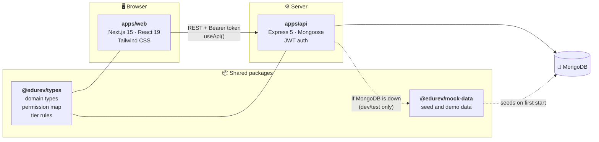

**Key design choice:** role permissions and tier rules are written **once** in `@edurev/types` and imported by both the API and the web app. So the screen can never show a button that the server would then refuse.

### How a request travels through the API

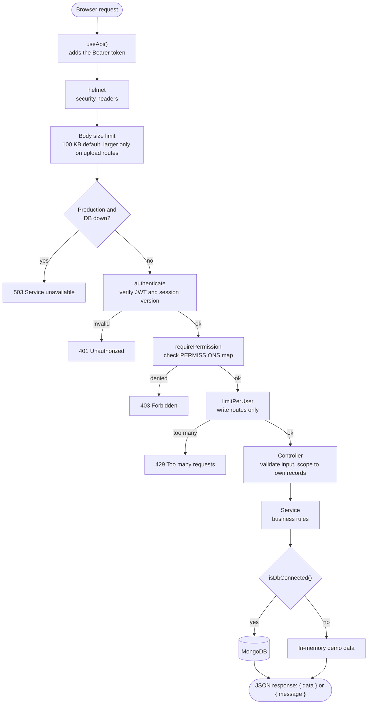

The backend is layered: `routes → middleware → controllers → services → models`. Every service runs in both modes, against MongoDB or against the demo data.

## 4. The student journey

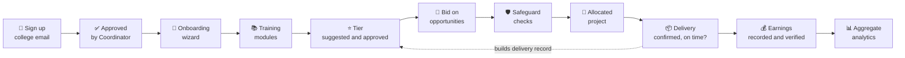

Every on-time delivery counts towards the student's record, which can later unlock the top tier (Elite).

## 5. Core workflows

### 5.1 Sign-up and approval

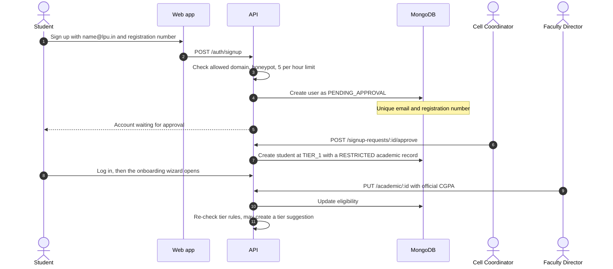

A CGPA typed in by the student is stored only as a *claim*. Safeguards and tier rules always use the **official** CGPA recorded by a Faculty Director.

### 5.2 Bidding and allocation

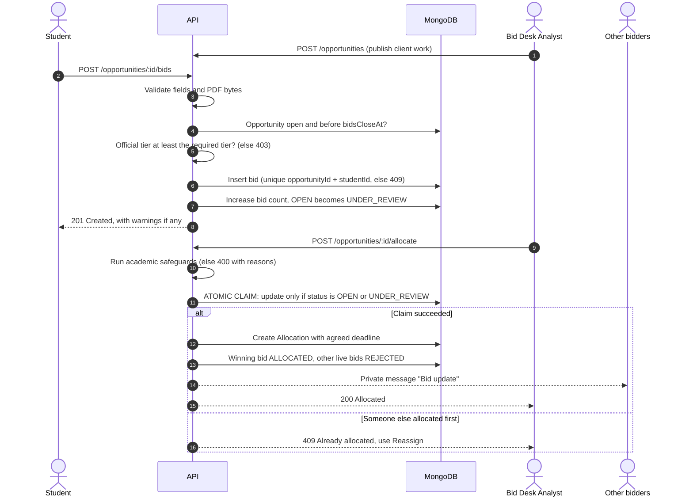

**Why an atomic claim?** If two staff members click *Allocate* at the same moment, only one database update can match `status: OPEN/UNDER_REVIEW`. The second one finds nothing to update and gets a friendly `409`. Two students can never be given the same project.

### 5.3 Status lifecycles

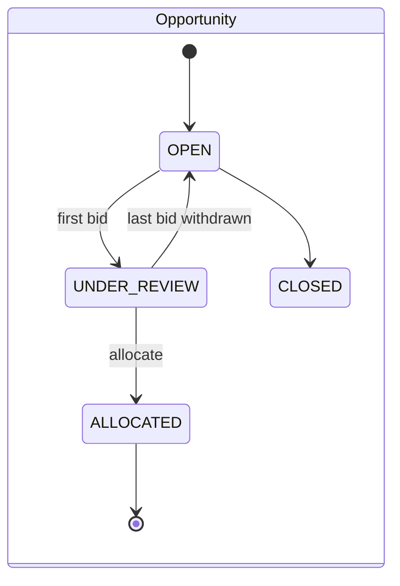

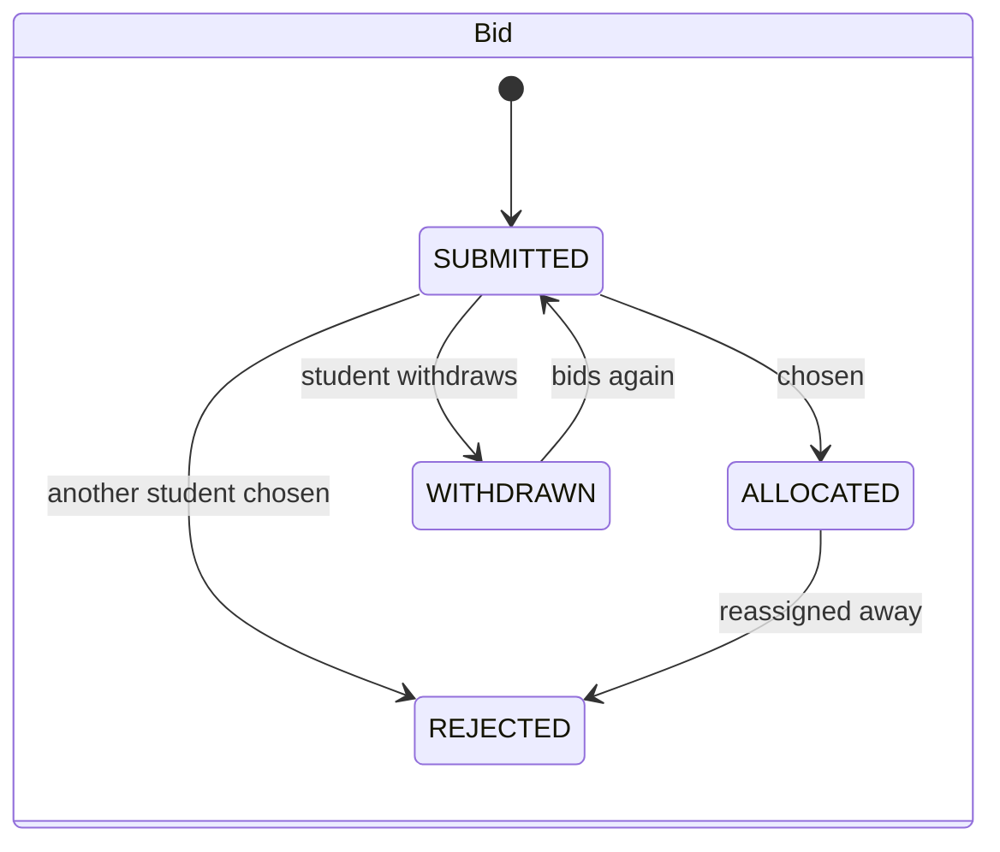

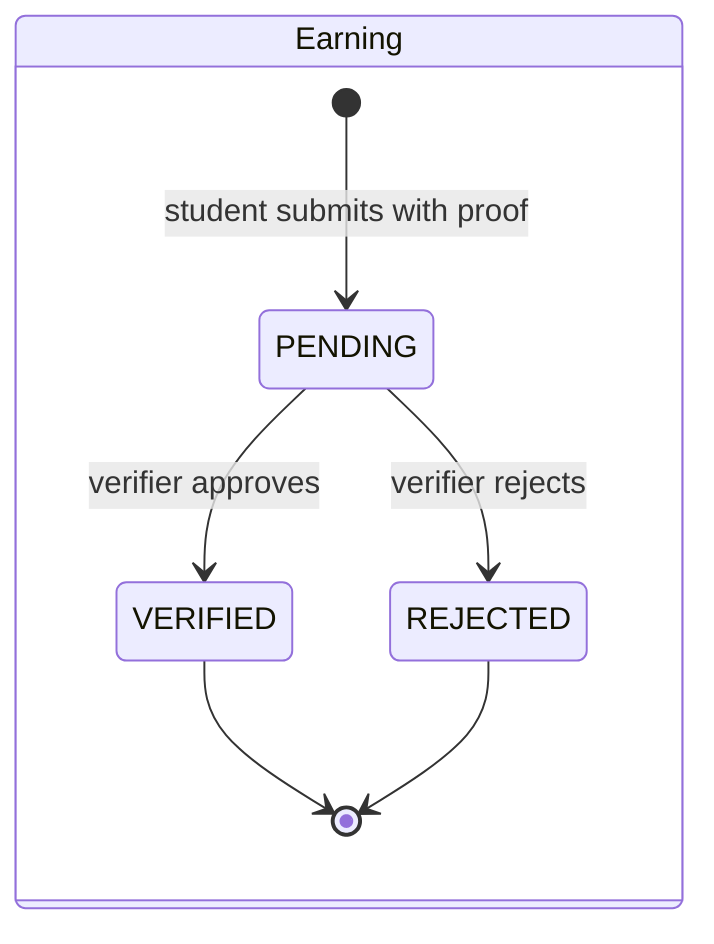

Every status change is a **conditional update** (`findOneAndUpdate({ ..., status: expected })`), never "read, then save". If two verifiers decide on the same earning at once, one succeeds and the other gets `409`.

### 5.4 Earnings verification

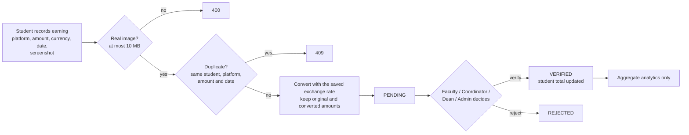

### 5.5 Messages

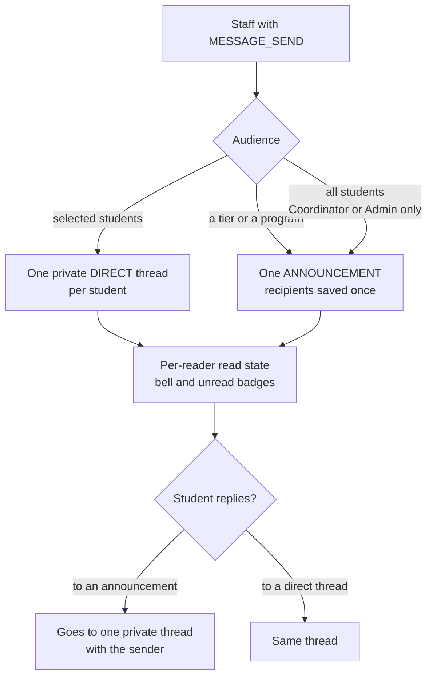

## 6. Tier progression

All tier rules live in one file: [`packages/types/src/tiers.ts`](packages/types/src/tiers.ts).

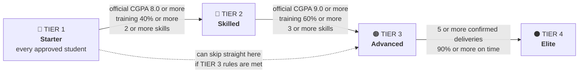

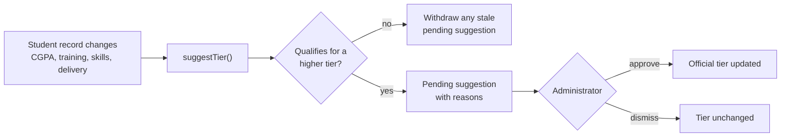

> **Rule:** training, onboarding and automation can only *suggest* a tier. **Only an Administrator can change an official tier.** Suggestions never move a student down.

## 7. Academic safeguards

These checks run when work is allocated and again when it is reassigned. They also produce warnings when a student places a bid.

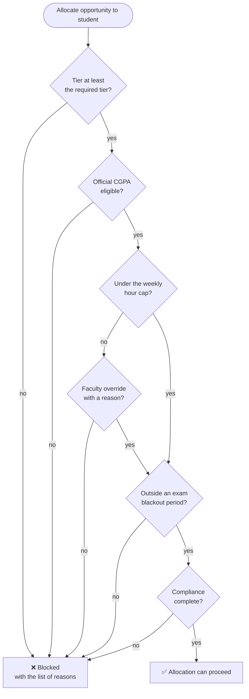

Hour-cap overrides are saved with an audit trail (`overrideReason`, `overriddenBy`, `overriddenAt`).

## 8. Roles and access control

Sign in at `/login`. Development accounts use the password `Password123!`.

| Role | Login | Main responsibilities |
| --- | --- | --- |
| Student | `student@revalanche.local` | Onboarding, training, bidding, recording earnings, replying to messages. **Own records only.** |
| Bid Desk Analyst | `analyst@…` | Publish opportunities, review bids, allocate work, confirm delivery |
| Proposal Editor | `editor@…` | Review bids and proposals |
| Guild Lead | `guild@…` | Mentor students, update training, message students |
| Cell Coordinator | `coordinator@…` | Approve sign-ups, allocate and reassign, override hour caps, verify earnings, message all students |
| Faculty Director | `faculty@…` | Record official CGPA, override hour caps, verify earnings |
| Placement Office | `placement@…` | View earnings and aggregate reporting |
| Dean | `dean@…` | Verify earnings, view reporting, message students |
| Administrator | `admin@…` | Everything above, plus **official tier changes**, direct assignment and institution settings |

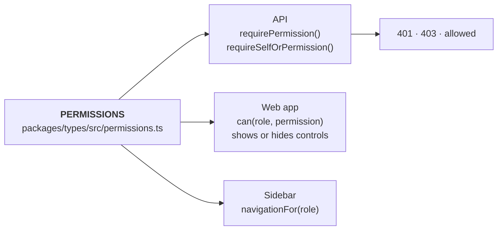

Hiding a link is never treated as access control. A protected page is guarded in **three** places: the sidebar, a `RequirePermission` page guard, and the API route itself. A student's identity always comes from the verified login token, never from the request body. The full permission table is in [docs/access-control.md](docs/access-control.md).

## 9. Data model

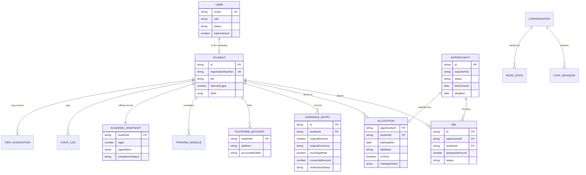

Other collections: `BlackoutPeriod`, `Proposal`, `Safeguard`, `Settings`.

**Database guarantees:**

- `unique(opportunityId, studentId)` on bids: one bid per student per opportunity.
- One allocation per opportunity.
- `unique(studentId, platformName, originalAmount, earningDate)` on earnings: no duplicate claims.
- Unique email and registration number on accounts.
- `PlatformAccount` stores **identifiers only**. Passwords, API keys and tokens are never stored.

Field-level notes are in [docs/data-model.md](docs/data-model.md).

## 10. Security

| Protection | How it works |
| --- | --- |
| Authentication | JWT sessions last **1 day**. Each token carries a version number, so a password change signs the user out of every other device. |
| Production safety | The server refuses to start without a 32+ character `JWT_SECRET` or without MongoDB. If the database drops later, the API returns `503` instead of falling back to demo data. |
| Uploads | Files are checked **by their bytes**, not by the declared type: PDFs must start with `%PDF-`, images must be real PNG, JPEG, WebP or GIF files. Non-PDF files always download as attachments. |
| Request limits | 100 KB request bodies by default. Larger limits apply only on the upload routes. |
| Rate limiting | Limits are per user, not per IP, because a whole campus shares IPs. Example: 30 bids per hour, 60 messages per 10 minutes. |
| Login protection | 10 failed attempts in 15 minutes returns `429`. Sign-up has a hidden honeypot field and a per-address limit. |
| Error hygiene | Database internals (`E11000`, `MongoServerError`, …) never reach the user. Errors always come back as `{ message }`. |
| Headers | `helmet` on the API. A Content Security Policy, `X-Frame-Options: DENY` and `nosniff` on the web app. |

Details: [docs/modules/security.md](docs/modules/security.md).

## 11. Demo data mode

The project can be shown in class even without a database.

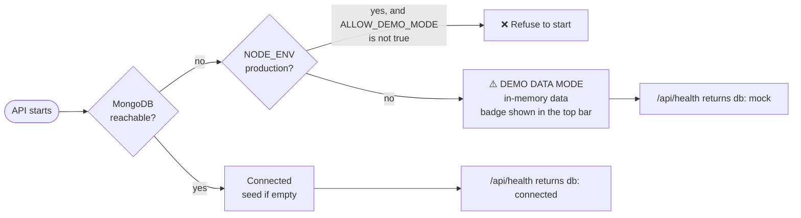

In demo mode, changes are kept in memory only and are lost on restart.

## 12. Getting started

### Prerequisites

- Node.js **20.9+** (22+ recommended) and npm 10+
- MongoDB running at `127.0.0.1:27017` (optional: without it the API runs in [demo data mode](#11-demo-data-mode))

### Install and run

```bash
git clone <repo-url> edRev
cd edRev
npm install
cp .env.example .env      # optional: defaults work for local development
npm run dev               # web on :3000, API on :4000
```

- Web app: <http://localhost:3000>
- API health check: <http://localhost:4000/api/health>

Sign in as `student@revalanche.local` / `Password123!` to see the student side, and as `analyst@`, `coordinator@` or `admin@revalanche.local` to see the staff side.

### Environment variables

| Variable | Default | Purpose |
| --- | --- | --- |
| `NEXT_PUBLIC_API_URL` | `http://localhost:4000/api` | API address used by the browser |
| `API_PORT` | `4000` | Express port |
| `WEB_ORIGIN` | `http://localhost:3000` | Allowed CORS origin |
| `MONGODB_URI` | `mongodb://127.0.0.1:27017/edurev` | Database connection |
| `JWT_SECRET` | dev value | Token signing secret (32+ characters required in production) |
| `JWT_EXPIRES_IN` | `1d` | Session length |
| `REQUIRE_DB` | `false` | Refuse to start without MongoDB |
| `ALLOW_DEMO_MODE` | `false` | Allow demo data mode in production (for a deliberate demo only) |
| `RATE_LIMIT_<BUCKET>` | see `.env.example` | Per-user write limits (`BIDS`, `EARNINGS`, `MESSAGES`, `UPLOADS`) |

## 13. Testing and quality

```bash
npm run typecheck                                  # all workspaces
npm test                                           # API tests against MongoDB
npm run test:mock --workspace @edurev/api          # the same tests in demo data mode
npm run build                                      # production build
```

**160 API tests** run in both modes, using Node's built-in `node:test` runner. Every test removes the records it creates.

| Suite | What it proves |
| --- | --- |
| `access-control` | Every endpoint returns 401 / 403 / allowed for anonymous, student, other-student and staff callers |
| `bids-allocation` | 5 simultaneous bids are all counted. Two simultaneous allocations give exactly one winner. Edit, withdraw and re-bid work. Rejected bidders get a message |
| `earnings` | Earnings always start PENDING. Duplicate claims are refused. Two simultaneous verifications give exactly one decision |
| `security` | Fake PDFs and images are refused. Old sessions end. Rate limits apply. Database errors are cleaned up |
| `signup` | Domain rules, duplicate accounts, the approval flow |
| `tiers-delivery` | Tier suggestions, the on-time delivery record, the Elite tier rules |
| `messages` | Audiences, read state, reply routing, withdrawal |
| `onboarding`, `profile`, `account-settings` | Profile limits, photo validation, password change, preferences |

If `npm run dev` is running, build into a separate folder so the two don't clash: `NEXT_DIST_DIR=.next-build npm run build --workspace @edurev/web`.

## 14. Project structure

```text
edRev/
├── apps/
│   ├── api/                      Express 5 REST API
│   │   └── src/
│   │       ├── routes/           URL → middleware → controller
│   │       ├── middleware/       authenticate, requirePermission, security
│   │       ├── controllers/      input validation, per-student scoping
│   │       ├── services/         business rules (MongoDB or demo data)
│   │       ├── models/           Mongoose schemas and unique indexes
│   │       ├── utils/            seed, rate limits, upload checks, timezone
│   │       └── tests/            node:test suites
│   └── web/                      Next.js 15 App Router
│       ├── app/(workspace)/      dashboard, opportunities, students, earnings,
│       │                         messages, proposals, safeguards, analytics, settings
│       ├── app/login, onboarding pages outside the workspace shell
│       ├── components/           screens, layout, shared UI
│       └── lib/                  useApi(), auth, navigation, work queue, toasts
├── packages/
│   ├── types/                    shared types, PERMISSIONS, TIER_RULES
│   └── mock-data/                seed and demo data
└── docs/                         architecture, access control, data model, modules
```

### Screens

| Route | Who | Purpose |
| --- | --- | --- |
| `/login` | Everyone | Sign in, or sign up as a student |
| `/onboarding` | New students | First-login wizard |
| `/dashboard` | Everyone | Overview and the "waiting for you" queue |
| `/opportunities`, `/opportunities/[id]` | Everyone | Opportunity pipeline and the Bid Desk |
| `/students`, `/students/[id]`, `/students/[id]/tier` | Staff | Student records, sign-up requests, tier suggestions, tier readiness |
| `/earnings` | Students and verifiers | Record and verify earnings |
| `/messages` | Everyone | Inbox, announcements and replies |
| `/proposals` | Everyone | Proposal workflow |
| `/safeguards` | Everyone | Academic and operational controls |
| `/analytics` | Staff | Aggregate program reporting |
| `/profile` | Everyone | Own profile and photo |
| `/settings/account`, `/settings` | Everyone / Admin | Password and preferences / institution settings |

## 15. API overview

All responses are JSON: `{ data }` on success, `{ message }` on error. Every route except `POST /api/auth/login`, the public sign-up endpoints and `GET /api/health` needs `Authorization: Bearer <token>`.

| Area | Endpoints |
| --- | --- |
| Auth | `POST /auth/login`, `POST /auth/signup`, `GET /auth/me`, `POST /auth/password`, `PATCH /auth/me/preferences` |
| Sign-ups | `GET /signup-requests`, `POST /signup-requests/:id/approve` and `/reject` |
| Opportunities | `GET/POST /opportunities`, `GET /opportunities/:id`, `POST /opportunities/:id/delivery` |
| Bids | `GET/POST /opportunities/:id/bids`, `PATCH /opportunities/:id/bids/mine`, `POST /opportunities/:id/bids/mine/withdraw` |
| Allocation | `POST /opportunities/:id/allocate`, `POST /opportunities/:id/reassign`, `GET /opportunities/:id/allocation` |
| Students | `GET /students`, `GET /students/:id` (+ `/readiness`, `/tier`, `/training`, `/delivery-record`), `PATCH /students/:id/profile`, `PUT/DELETE /students/:id/photo` |
| Tiers | `PATCH /students/:id/tier`, `GET /tier-suggestions`, `POST /tier-suggestions/:id/approve` and `/dismiss` |
| Academic and safeguards | `PUT /academic/:id`, `GET /safeguards/:studentId`, `GET/POST /hours`, `GET /blackouts`, `POST /safeguards/hour-cap/override` |
| Earnings | `GET/POST /earnings`, `PATCH /earnings/:id/verify`, `GET /platform-accounts` |
| Messages | `GET/POST /messages`, `GET /messages/unread-count`, `POST /messages/:id/replies`, `POST /messages/:id/read`, `POST /messages/:id/withdraw` |
| Reporting | `GET /dashboard`, `GET /analytics`, `GET/PUT /settings` |

## 16. Roadmap and limitations

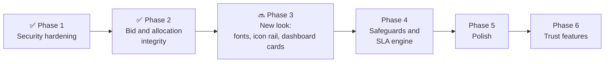

Already delivered: profiles and photo upload, onboarding, student sign-up, official academic records, tier suggestions, delivery tracking, messages, security hardening, and bid and allocation integrity.

**Current limitations (stated honestly):**

- Weekly hours are validated but not yet stored per week. This is planned for the Phase 4 safeguards engine.
- SLA deadlines are stored on allocations, but no background job advances the SLA status yet.
- There is no database migration system. The database is seeded on first start.
- There is no integration with external freelancing platforms. This is deliberate, to avoid handling credentials.
- Messages refresh every 30 seconds rather than being pushed instantly.

The full plan is in [docs/improvement-plan.md](docs/improvement-plan.md).

## 17. Further documentation

| Document | Contents |
| --- | --- |
| [docs/architecture.md](docs/architecture.md) | Request flow, workspace responsibilities, frontend design |
| [docs/access-control.md](docs/access-control.md) | Full permission and endpoint rule tables |
| [docs/data-model.md](docs/data-model.md) | Entities, fields and database constraints |
| [docs/modules/bids-and-allocation.md](docs/modules/bids-and-allocation.md) | Bidding and allocation rules, edge cases, tests |
| [docs/modules/security.md](docs/modules/security.md) | Security rules S1–S13 |
| [docs/edge-cases.md](docs/edge-cases.md) | Catalogue of edge cases and how each is handled |
| [docs/component-tree.md](docs/component-tree.md) | Web component hierarchy |
| [docs/improvement-plan.md](docs/improvement-plan.md) | Phased roadmap and open decisions |

---

<div align="center">

**Built by the REVALANCHE team**: no commission, no stored credentials, students' studies first.

</div>
