<div align="center">


# EduRev · REVALANCHE

**From training to real client work, without putting studies at risk.**


[About](#about) · [Features](#features) · [Architecture](#architecture) · [Workflows](#workflows) · [Quick start](#quick-start) · [Docs](#documentation)

</div>

---

## Table of contents

- [About](#about)
- [Features](#features)
- [Architecture](#architecture)
- [Workflows](#workflows)
  - [Student journey](#student-journey) · [Sign-up and approval](#sign-up-and-approval) · [Tiers](#tiers) · [Academic safeguards](#academic-safeguards)
  - [Allocation](#allocation) · [Earnings](#earnings) · [Messages](#messages) · [Status lifecycles](#status-lifecycles)
- [Data model](#data-model)
- [Roles](#roles)
- [Tech stack](#tech-stack)
- [Quick start](#quick-start)
- [Scripts](#scripts)
- [Project structure](#project-structure)
- [Roadmap](#roadmap)
- [Documentation](#documentation)
- [Contributing](#contributing)

## About

EduRev is a role-based college workspace. Students train, bid on curated client projects and get allocated work, subject to academic safeguards. They record their freelance earnings, and staff verify them. The institution sees aggregate reporting only.

> The institution takes **no commission**, there is **no payment gateway**, and platform passwords or API keys are **never stored**.

## Features

| | |
| --- | --- |
| 🎓 **Onboarding** | Student self sign-up with a college email, coordinator approval, first-login wizard |
| 📚 **Training and tiers** | Four tiers (Starter → Elite). The system suggests a tier; only an Administrator approves it |
| 💼 **Bid desk** | One bid per student per project, PDF proposals, edit or withdraw while bidding is open |
| ⚖️ **Fair allocation** | Atomic claim, so exactly one student gets each project; reassignment needs a reason |
| 🛡️ **Academic safeguards** | Checks official CGPA, weekly hours, exam blackouts and compliance before allocating |
| 💰 **Earnings** | Proof screenshot, original currency kept, verified by faculty or the Dean |
| ✉️ **Messages** | Direct messages and announcements to a tier, a program or all students |
| 📊 **Analytics** | Aggregate program reporting, with no individual leaderboard |

## Architecture

<p align="center">
  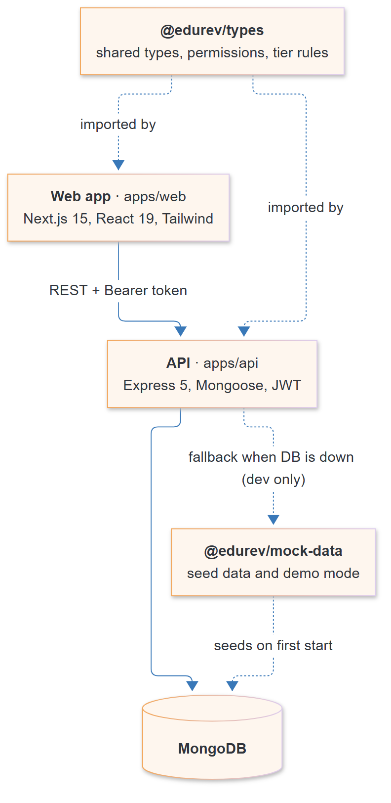
</p>

A TypeScript monorepo with npm workspaces. Role permissions and tier rules are defined **once** in `@edurev/types` and used by both the web app and the API, so the UI never shows an action the server would refuse.

### Request flow

<p align="center">
  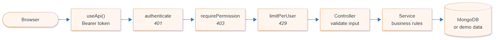
</p>

Every route except login and health checks goes through `authenticate`. Each service works against MongoDB, or against in-memory demo data when the database is down (development only).

## Workflows

### Student journey

<p align="center">
  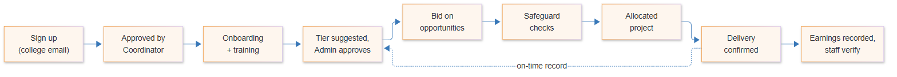
</p>

### Sign-up and approval

<p align="center">
  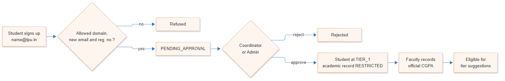
</p>

A CGPA typed in by the student is only a *claim*. Safeguards and tier rules always use the **official** CGPA recorded by a Faculty Director.

### Tiers

<p align="center">
  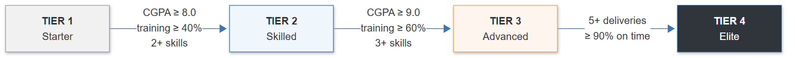
</p>

<p align="center">
  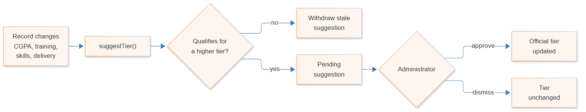
</p>

Training, onboarding and automation can only **suggest** a tier. Only an Administrator changes an official tier. Rules live in [`packages/types/src/tiers.ts`](packages/types/src/tiers.ts).

### Academic safeguards

<p align="center">
  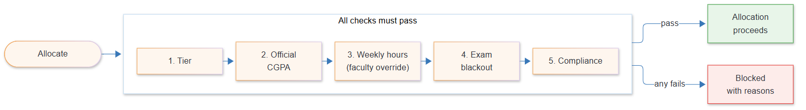
</p>

### Allocation

<p align="center">
  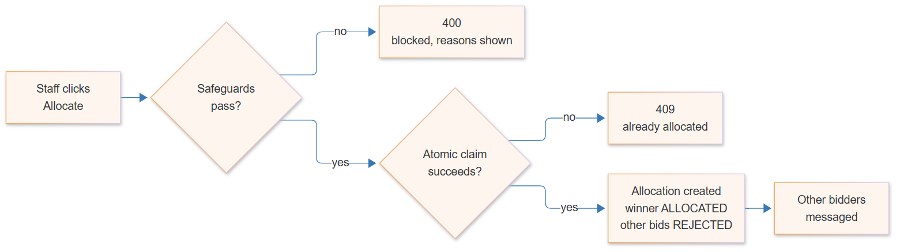
</p>

If two staff members click **Allocate** at the same moment, only one database update can match the open status. The other gets `409`, so two students can never get the same project.

### Earnings

<p align="center">
  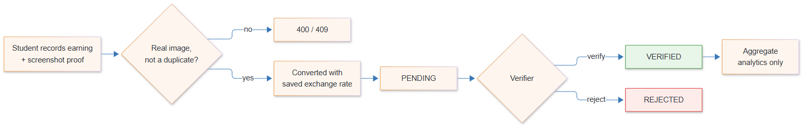
</p>

### Messages

<p align="center">
  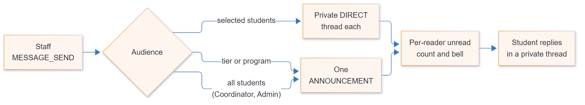
</p>

### Status lifecycles

<p align="center">
  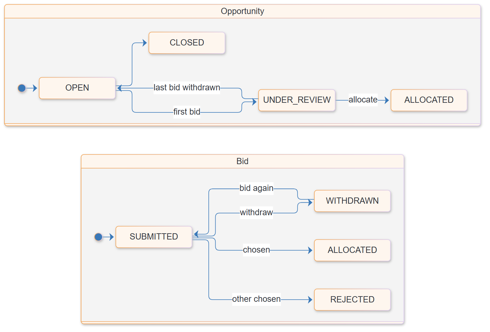
</p>

Every status change is a conditional update (`findOneAndUpdate({ …, status: expected })`), never "read, then save".

## Data model

<p align="center">
  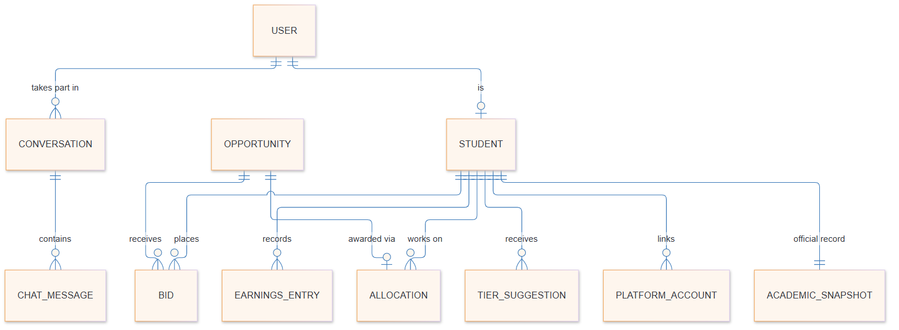
</p>

- One bid per student per opportunity (unique index), one allocation per opportunity.
- No duplicate earnings claims; unique email and registration number per account.
- `PlatformAccount` stores **identifiers only**, never passwords or tokens.

Field-level details: [docs/data-model.md](docs/data-model.md).

## Roles

| Role | Main responsibilities |
| --- | --- |
| Student | Onboarding, training, bidding, earnings, replying to messages (own records only) |
| Bid Desk Analyst | Publish opportunities, review bids, allocate, confirm delivery |
| Proposal Editor | Review bids and proposals |
| Guild Lead | Mentor students, update training, message students |
| Cell Coordinator | Approve sign-ups, allocate and reassign, verify earnings, message all students |
| Faculty Director | Record official CGPA, override hour caps, verify earnings |
| Placement Office | View earnings and aggregate reporting |
| Dean | Verify earnings, view reporting, message students |
| Administrator | Everything, plus official tier changes and institution settings |

Permissions are defined in [`packages/types/src/permissions.ts`](packages/types/src/permissions.ts). Full table: [docs/access-control.md](docs/access-control.md).

## Tech stack

| Layer | Tools |
| --- | --- |
| Frontend | Next.js 15 (App Router), React 19, Tailwind CSS 3 |
| Backend | Express 5, Mongoose, JWT, helmet |
| Database | MongoDB (falls back to in-memory demo data in development) |
| Testing | `node:test`, run against MongoDB and in demo data mode |

## Quick start

**Prerequisites:** Node.js 20.9+, npm 10+. MongoDB at `127.0.0.1:27017` is optional; without it the API runs in demo data mode.

```bash
git clone https://github.com/ItsShivam05/edRev.git
cd edRev
npm install
cp .env.example .env   # defaults work for local development
npm run dev            # web → http://localhost:3000 · API → http://localhost:4000
```

### Demo accounts

Password for all accounts: `Password123!`

| Role | Email |
| --- | --- |
| Student | `student@revalanche.local` |
| Bid Desk Analyst | `analyst@revalanche.local` |
| Cell Coordinator | `coordinator@revalanche.local` |
| Faculty Director | `faculty@revalanche.local` |
| Administrator | `admin@revalanche.local` |

Also available: `editor@`, `guild@`, `placement@`, `dean@`.

### Environment variables

| Variable | Default | Purpose |
| --- | --- | --- |
| `NEXT_PUBLIC_API_URL` | `http://localhost:4000/api` | API address used by the browser |
| `API_PORT` | `4000` | API port |
| `WEB_ORIGIN` | `http://localhost:3000` | Allowed CORS origin |
| `MONGODB_URI` | `mongodb://127.0.0.1:27017/edurev` | Database connection |
| `JWT_SECRET` | dev value | Token secret (32+ characters required in production) |
| `REQUIRE_DB` | `false` | Refuse to start without MongoDB |

See [`.env.example`](.env.example) for the full list.

## Scripts

| Command | What it does |
| --- | --- |
| `npm run dev` | Start web and API together |
| `npm run typecheck` | Type-check all workspaces |
| `npm test` | API tests against MongoDB |
| `npm run test:mock --workspace @edurev/api` | Same tests in demo data mode |
| `npm run build` | Production build of web and API |

## Project structure

```text
edRev/
├── apps/
│   ├── api/          Express API: routes → middleware → controllers → services → models
│   └── web/          Next.js app: pages in app/(workspace)/, screens in components/
├── packages/
│   ├── types/        shared types, PERMISSIONS, TIER_RULES
│   └── mock-data/    seed and demo data
└── docs/             architecture, access control, data model, module notes, diagrams
```

## Roadmap

<p align="center">
  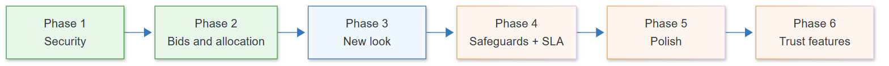
</p>

Green: done · Blue: next · Orange: planned. Details in [docs/improvement-plan.md](docs/improvement-plan.md).

## Documentation

| Document | Contents |
| --- | --- |
| [Architecture](docs/architecture.md) | Request flow and workspace responsibilities |
| [Access control](docs/access-control.md) | Roles, permissions and endpoint rules |
| [Data model](docs/data-model.md) | Collections, fields and unique indexes |
| [Bids and allocation](docs/modules/bids-and-allocation.md) | Bidding and allocation rules |
| [Security](docs/modules/security.md) | Sessions, uploads, rate limits, error handling |
| [Edge cases](docs/edge-cases.md) | Known edge cases and how each is handled |
| [Improvement plan](docs/improvement-plan.md) | Roadmap and open decisions |

## Contributing

1. Create a branch from `main`.
2. Keep changes additive: don't rename or remove existing fields, routes or exports.
3. Add an access-control test (401 / 403 / allowed) for every new endpoint.
4. Before opening a PR, run `npm run typecheck`, `npm test` and `npm run test:mock --workspace @edurev/api`.

### Editing diagrams

Diagram sources are the `.mmd` files in [`docs/diagrams/`](docs/diagrams/). After editing one, regenerate its image:

```bash
npx @mermaid-js/mermaid-cli -i docs/diagrams/<name>.mmd -o docs/diagrams/<name>.png -s 2 -b white
```
